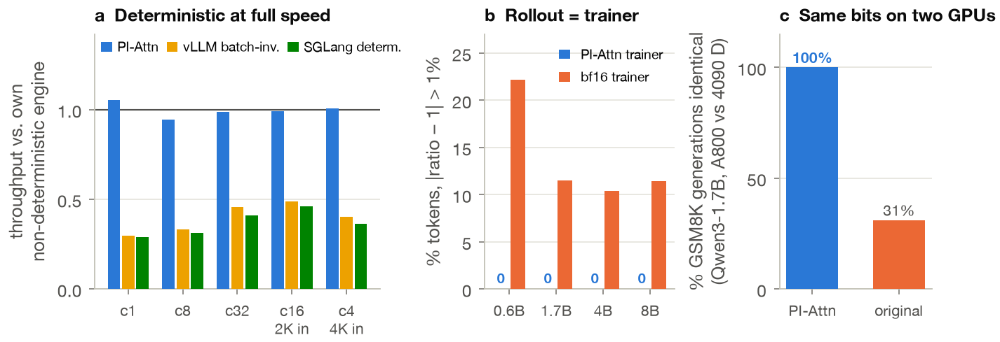
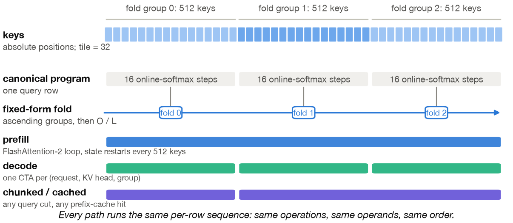

<div align="center">

# PI-Attn

**Bitwise-reproducible LLM serving — with every optimization on, at full speed.**

[Paper (PDF)](paper/paper.pdf) · [Engine](llm_infer_rust/) · [Kernels](llm_infer_rust/src/kernels/pi/) · [Results](results/README.md)

</div>



Ask an LLM server the same question twice at temperature 0 and you can get two different answers. Batching, prefix caching, chunked prefill, split-KV decode and the prefill/decode split all reorder floating-point sums. Existing deterministic modes switch those optimizations off and lose more than half their throughput.

**PI-Attn fixes the floating-point *program* instead of the *schedule*.** Every query row and every output element executes one canonical sequence of operations that depends only on positions and shapes. That sequence is chosen so that its free partitions are exactly the ones fast kernels want. Prefill, chunked prefill, prefix-cache hits and decode become bitwise identical by construction, while tiling, pipelining, stream-K and even the tensor-parallel degree stay free.

## Highlights

On one A800, Qwen3 0.6B–8B, with radix caching, chunked prefill, CUDA graphs and CPU/GPU overlap all enabled:

- **No throughput cost.** On average (geometric mean over 40 workloads) the deterministic mode is **1.2% faster** than the same engine without determinism. It is on par with vLLM 0.17.1.
- **2.0–3.7× faster than vLLM's batch-invariant mode**, the only other engine that passes our numeric checks.
- **Bitwise identical** tokens *and* log-probabilities across concurrency, prefix-cache state, chunking, decode vs. re-prefill, seeded sampling, eight server configurations and restarts.
- **Rollout = trainer.** A PyTorch forward on the same kernels reproduces all **55,593** rollout log-probabilities bit for bit, so every importance ratio is exactly 1. A standard bf16 trainer misses by more than 1% on 10–22% of tokens.
- **Same bits on two GPU architectures.** Every kernel output and every GSM8K generation is identical across an A800 (sm_80) and an RTX 4090 D (sm_89).
- **Beyond softmax attention.** Gated DeltaNet decodes with the trainer's own chunked program inside vLLM, bitwise and at stock throughput, with speculative decoding for free.

## How it works

<p align="center"></p>

**Attention.** Keys are cut at absolute positions into 512-key fold groups. Each group is an online softmax over 32-key tiles, and the groups fold in a fixed order. A prefill kernel is FlashAttention-2 restarting its state every 512 keys, and a decode kernel gives every group its own CTA. Any chunked or cached split runs the same per-row sequence.

**Projections.** Each output element runs one `mma.m16n8k16` chain over K, cut into a number of segments fixed by the weight's shape. Tiles never enter the chain, so an autotuner can choose freely among small-M streaming kernels, CUTLASS tiles, segment-parallel kernels and **deterministic stream-K**. Stream-K hands the fp32 accumulator from worker to worker, which gives split-K's load balance without its reduction.

The full numerical contract, which parameters define the bits and which are free, is in §2.3 of the [paper](paper/paper.pdf).

## Quick start

```bash
git clone https://github.com/HaochengLu/pi-attn.git && cd pi-attn
bash setup_env.sh && source env.sh      # CUDA 12.6, gcc 13, Rust, Python 3.12, four venvs, Qwen3 models, all under env/
(cd llm_infer_rust && FLASHINFER_CUDA_ARCH=80 cargo build --release)   # 80 = A100/A800, 89 = Ada

scripts/serve.sh 8000 models/Qwen3-1.7B --deterministic
python detcheck/detcheck.py --url http://127.0.0.1:8000 --tokenizer models/Qwen3-1.7B --logprobs
```

`--deterministic` turns on PI-Attn, the row-invariant GEMM and (seed, position)-keyed sampling, and disables nothing. Requests with `"logprobs": 0` also return each sampled token's log-probability. Requests without a seed get a random one, echoed in the response, so any output can be replayed.

[`detcheck`](detcheck/detcheck.py) works against any OpenAI-compatible server (vLLM and SGLang included). It compares token ids and the fp32 bits of every log-probability.

## Reproduce the paper

```bash
eval/run_all.sh        # rebuilds the engine, runs every test and benchmark (~8 h on one A800)
cd paper && python figures.py ../results figs && bash build.sh    # redraw the figures, rebuild paper.pdf
```

[`results/README.md`](results/README.md) maps every table and figure to the files that hold its numbers. The A800 run is in `results/a800/`; the earlier RTX 4090 D run is at the top level of `results/`. Set `BASELINE_ENGINES="rust rust-det sglang sglang-det vllm vllm-det vllm17 vllm17-det"` to include the SGLang and vLLM baselines.

## Repository

| Path | What |
|---|---|
| [`paper/`](paper/) | The paper (`paper.pdf`, source `paper.md`), figures and the scripts that draw and typeset them |
| [`llm_infer_rust/`](llm_infer_rust/) | The Rust/libtorch serving engine with `--deterministic`; PI-Attn and the row-invariant GEMM live in [`src/kernels/pi/`](llm_infer_rust/src/kernels/pi/), the mode is documented in [`docs/deterministic-mode.md`](llm_infer_rust/docs/deterministic-mode.md) |
| [`kernels/`](kernels/) | PyTorch bindings, invariance tests, mutation controls, tensor-parallel invariance, kernel benchmarks, the trainer forward (`engine_forward.py`) |
| [`detcheck/`](detcheck/) | Black-box determinism checker for OpenAI-compatible servers |
| [`eval/`](eval/) | End-to-end benchmarks, baselines, GSM8K, fp32 agreement, rollout log-probabilities, `run_all.sh` |
| [`gdn/`](gdn/) | Exact Gated DeltaNet decode and its vLLM 0.17.1 integration |
| [`results/`](results/) | Every number in the paper |
| [`requirements/`](requirements/) | Exact package lists of the four Python environments and model hashes |
| [`archive/`](archive/) | Earlier kernel versions and every measured optimization attempt, kept or rejected |

## Tests

```bash
cd kernels && python test_invariance.py && python test_matrix.py && python test_directed.py \
           && python test_gemm.py && python test_mutants.py
python test_tp_model.py                                   # tensor-parallel degree invariance on Qwen3-8B
cd ../llm_infer_rust && VENV_DIR=$VIRTUAL_ENV scripts/run-rust-tests.sh cuda
```

`test_mutants.py` runs deliberately broken kernels through the suite and requires it to catch every one.

<details>
<summary>Environment notes</summary>

Everything, caches included, is installed under `env/` by `setup_env.sh` (idempotent); nothing is written to the host system or `$HOME`. Python packages come from the lock files in `requirements/`, the models from ModelScope (checked against `requirements/models.sha256`), and `VERSIONS.txt` is regenerated on every run. Download sources default to mirrors reachable from mainland China; `setup_env.sh` lists the variables that point them elsewhere.

- torch cu126 wheels run on driver 535 through CUDA minor-version compatibility; the CUDA 13 wheels do not.
- CUDA 12.6 nvcc needs gcc ≤ 13, so `env.sh` points CC/CXX/NVCC_CCBIN at a conda-forge gcc 13 in `env/gcc13`.
- Driver 535 rejects FlashInfer's compressed fatbins; `env/bin/nvcc-nocompress` strips `--compress-mode=size`.
- `env.sh` unsets a host-wide `CXXFLAGS=-std=c++17`, which would override the engine's C++20 flags.
- Behind a slow link to PyPI, set `HTTP_PROXY`/`HTTPS_PROXY`. Exclude internal mirrors with `NO_PROXY`. `setup_env.sh` takes uv from its PyPI wheel.
- One upstream engine CUDA test, `segmented_prefill_matches_eager_logits_and_kv...` (FlashInfer backend), also fails on upstream `main`. It is unrelated to this work.

</details>

## Citation

```bibtex
@misc{lu2026piattn,
  title  = {Fix the Program, Not the Schedule: Bitwise-Reproducible {LLM} Serving with Every Optimization On},
  author = {Haocheng Lu},
  year   = {2026},
  url    = {https://github.com/HaochengLu/pi-attn}
}
```
